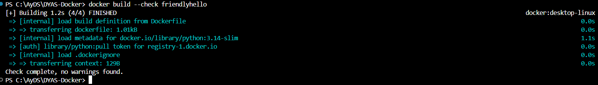
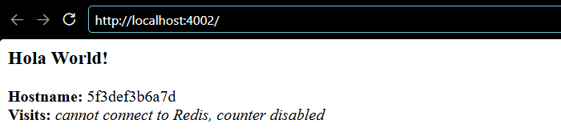

# Imágenes

## Paso 1: primer Dockerfile (`hello-world/`)

```dockerfile
FROM busybox:1.37
COPY hello /
RUN cat /hello
```

`docker build --progress=plain -t helloapp:v1 .` muestra la salida de `RUN` durante la construcción:

```text
#7 [3/3] RUN cat /hello
#7 0.278 hello
#8 naming to docker.io/library/helloapp:v1 done
```

```text
REPOSITORY   TAG       IMAGE ID       CREATED        SIZE
helloapp     v1        9970a1a2f318   1 second ago   6.79MB
```

`RUN` se ejecuta **una sola vez, al construir**. El `hello` queda impreso en el log del *build*, no cada vez que se crea un contenedor.

Salidas completas: [`evidencias/01-hello-build.txt`](../blob/main/evidencias/01-hello-build.txt) y [`evidencias/01-hello-images.txt`](../blob/main/evidencias/01-hello-images.txt).

## Pasos 2 y 3: `friendlyhello`

```dockerfile
FROM python:3.14-slim
WORKDIR /app
COPY requirements.txt .
RUN pip install --no-cache-dir -r requirements.txt
COPY . .
RUN useradd --system --no-create-home app
USER app
ENV NAME=World
EXPOSE 8000
HEALTHCHECK --interval=30s --timeout=3s --start-period=10s --start-interval=2s --retries=3 \
  CMD python -c "import urllib.request; urllib.request.urlopen('http://localhost:8000/health', timeout=2)"
CMD ["gunicorn", "--bind", "0.0.0.0:8000", "--workers", "2", "app:app"]
```

### Qué buena práctica cumple cada instrucción

| Buena práctica | Cómo se cumple | Qué se gana |
|----------------|----------------|-------------|
| Versiones fijas | `requirements.txt` con `==` (`Flask==3.1.3`, `redis==8.1.0`, `gunicorn==26.2.0`) e imagen base fijada en `python:3.14-slim` | Las dependencias de la aplicación son exactamente las mismas en cada *build*. La imagen base queda fijada en la versión menor 3.14: recibe los parches 3.14.x y de Debian, pero nunca salta a 3.15. Para una reproducibilidad total habría que fijarla por *digest* (`python:3.14-slim@sha256:…`), como se hizo con versión completa en el [proyecto Java](6-Proyecto). |
| Imagen base pequeña | Variante `-slim` | `python:3.14-slim` pesa 43,8 MB comprimida frente a 415,8 MB de `python:3.14` completa (unas 9,5 veces menos); la imagen final de `friendlyhello` ocupa 215 MB en disco. Menos paquetes significa menos superficie de ataque. |
| Orden de capas | `requirements.txt` y `pip install` antes de `COPY . .` | Al cambiar el código no se reinstalan las dependencias (ver [Caché de capas](2-Cache-de-capas)). |
| `.dockerignore` | Excluye `data/`, `docker-compose*.yaml`, `Dockerfile*`, `.git`, `__pycache__/` | El contexto que se envía al *build* pesa 129 B y los datos de Redis no terminan dentro de la imagen. |
| Usuario sin privilegios | `useradd --system` + `USER app` | Si se compromete la aplicación, el atacante no es `root` dentro del contenedor. |
| `HEALTHCHECK` propio | `/health` no depende de Redis | Docker y Traefik saben si la réplica responde, sin marcarla como caída cuando falla Redis. |
| Servidor de producción | `gunicorn` con 2 *workers* (procesos) | El servidor integrado de Flask es solo para desarrollo: al iniciarlo, Flask advierte que no debe usarse en producción. gunicorn reparte las peticiones entre varios procesos y reinicia un *worker* si se bloquea. |
| `ENV clave=valor` | `ENV NAME=World` | Evita la advertencia `LegacyKeyValueFormat`. |
| Puerto mayor a 1024 | `EXPOSE 8000` | Un usuario sin privilegios no puede abrir puertos menores a 1024. |

### `docker build --check` sin advertencias

```text
$ docker build --check .
#3 transferring context: 129B done
Check complete, no warnings found.
```



### Ejecución: contenedor `healthy` y usuario sin privilegios

```text
$ docker run --rm -p 4001:8000 friendlyhello
$ curl http://localhost:4001
Hello World!  Hostname: f59e209e7a78  Visits: cannot connect to Redis, counter disabled

$ docker ps
CONTAINER ID   IMAGE           STATUS                    PORTS
f59e209e7a78   friendlyhello   Up 13 seconds (healthy)   0.0.0.0:4001->8000/tcp

$ docker exec f59e209e7a78 id
uid=999(app) gid=999(app) groups=999(app)
```



*La captura se tomó después del Paso 4 (por eso dice "Hola" en lugar de "Hello"), con otro contenedor (`docker run --rm -p 4002:8000 friendlyhello`); de ahí que el* hostname *y el puerto sean distintos a los de la salida de texto.*

El *hostname* es el ID del contenedor. El contador está deshabilitado porque todavía no hay Redis, y la aplicación **no se cae** por eso: los *timeouts* cortos y `Retry(NoBackoff(), 0)` hacen que responda en pocos segundos.

Salidas completas: [`evidencias/03-build-check.txt`](../blob/main/evidencias/03-build-check.txt), [`evidencias/03-run.txt`](../blob/main/evidencias/03-run.txt) y [`evidencias/01-tamanos.txt`](../blob/main/evidencias/01-tamanos.txt) (tamaños de las imágenes).
