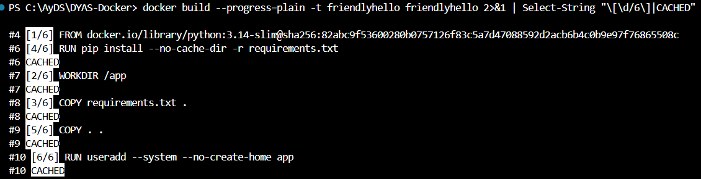

# Caché de capas (Paso 4)

## Experimento

1. Con el Dockerfile correcto (dependencias antes que el código), se cambió `Hello` por `Hola` en `app.py` y se reconstruyó.
2. Para la pregunta de discusión se creó [`Dockerfile.malorden`](../blob/main/friendlyhello/Dockerfile.malorden), idéntico pero con `COPY . .` **antes** de `RUN pip install`. Se construyó una vez para calentar la caché, se hizo otro cambio en `app.py` (un comentario) y se reconstruyó.
3. Con ese mismo cambio se reconstruyó también el Dockerfile correcto, para comparar en igualdad de condiciones.

## Evidencia de `CACHED` con el orden correcto

```text
#6 [2/6] WORKDIR /app
#6 CACHED
#7 [3/6] COPY requirements.txt .
#7 CACHED
#8 [4/6] RUN pip install --no-cache-dir -r requirements.txt
#8 CACHED
#9 [5/6] COPY . .
#10 [6/6] RUN useradd --system --no-create-home app
```



*La captura corresponde a una reconstrucción **sin cambios** en el código, por eso todas las capas, incluida `COPY . .`, aparecen en `CACHED`. La salida de texto de arriba es la reconstrucción **después** de cambiar `app.py`: ahí `COPY . .` y las capas siguientes se vuelven a ejecutar, pero `pip install` sigue en `CACHED`.*

## Orden incorrecto: `pip install` se repite

```text
#8 [4/5] RUN pip install --no-cache-dir -r requirements.txt
#8 DONE 24.1s
```

## Comparación de tiempos

Todas las mediciones son después de modificar `app.py`, con la caché caliente y la imagen base ya descargada:

| Dockerfile | Cambio | Tiempo total | `pip install` |
|------------|--------|-------------:|---------------|
| Correcto (`requirements.txt` → `pip` → `COPY . .`) | `Hello` → `Hola` | **4,21 s** | `CACHED` |
| Correcto | comentario nuevo | **4,49 s** | `CACHED` |
| Incorrecto (`COPY . .` → `pip`) | comentario nuevo | **32,27 s** | reinstala (24,1 s) |

Con el orden incorrecto cada cambio en el código cuesta **unas 7,5 veces más**.

## Explicación

Docker cachea cada capa a partir de la instrucción **y** del contenido que usa. En `COPY` ese contenido es el *checksum* de los archivos copiados. Cuando una capa se invalida, se invalidan también **todas las que vienen después**.

- **Orden correcto:** `COPY requirements.txt` solo cambia si cambia `requirements.txt`. Al tocar `app.py` se invalida a partir de `COPY . .`, y `pip install` está antes, así que se reutiliza.
- **Orden incorrecto:** `COPY . .` incluye `app.py`, de modo que cualquier cambio en el código invalida esa capa y arrastra a `pip install`, que vuelve a descargar e instalar Flask, Redis y gunicorn.

La diferencia crece con el proyecto. En el proyecto Java la misma idea (`COPY pom.xml` → `dependency:go-offline` → `COPY src`) evita descargar todas las dependencias de Maven en cada *build*, que es justamente lo que más tarda (ver [Proyecto](6-Proyecto)). En un pipeline de CI cada minuto ahorrado se multiplica por cada *push* del equipo.

Salidas completas: [`evidencias/04-cache-comparacion.txt`](../blob/main/evidencias/04-cache-comparacion.txt), [`04-cache-orden-correcto.txt`](../blob/main/evidencias/04-cache-orden-correcto.txt) y [`04-cache-orden-incorrecto.txt`](../blob/main/evidencias/04-cache-orden-incorrecto.txt).
