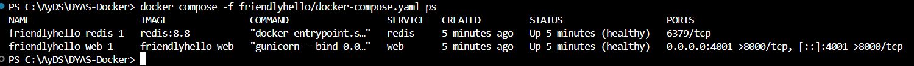

# Docker Compose (Paso 5)

[`friendlyhello/docker-compose.yaml`](../blob/main/friendlyhello/docker-compose.yaml):

```yaml
services:
  web:
    build: .
    ports:
      - "${WEB_PORT:-4000}:8000"
    depends_on:
      redis:
        condition: service_healthy
  redis:
    image: redis:8.8
    command: redis-server --appendonly yes
    volumes:
      - ./data:/data
    healthcheck:
      test: ["CMD", "redis-cli", "ping"]
      interval: 5s
      timeout: 3s
      retries: 5
```

## Orden de arranque

Compose espera a que Redis esté `Healthy` antes de iniciar `web`:

```text
 Container friendlyhello-redis-1  Started
 Container friendlyhello-redis-1  Waiting
 Container friendlyhello-redis-1  Healthy
 Container friendlyhello-web-1  Starting
 Container friendlyhello-web-1  Started
```

Un `depends_on` sin condición solo espera a que el contenedor de Redis **exista**. Si `web` arrancara antes de que Redis acepte conexiones, las primeras peticiones mostrarían *"cannot connect to Redis"*.

## Contador de visitas funcionando

```text
Hola World!  Hostname: c5802bdd2cad  Visits: 1
Hola World!  Hostname: c5802bdd2cad  Visits: 2
Hola World!  Hostname: c5802bdd2cad  Visits: 3
Hola World!  Hostname: c5802bdd2cad  Visits: 4
Hola World!  Hostname: c5802bdd2cad  Visits: 5
```


*La captura se tomó en una ejecución posterior: el contador va en 32 porque el volumen `./data` conservó las visitas de todas las pruebas anteriores.*

## `docker compose ps`

```text
NAME                    IMAGE               STATUS                    PORTS
friendlyhello-redis-1   redis:8.8           Up 14 seconds (healthy)   6379/tcp
friendlyhello-web-1     friendlyhello-web   Up 8 seconds (healthy)    0.0.0.0:4001->8000/tcp
```



*Captura de la misma ejecución que la del contador, desde la raíz del repositorio (`docker compose -f friendlyhello/docker-compose.yaml ps`).*

Los dos servicios aparecen `healthy`: `web` por el `HEALTHCHECK` del Dockerfile y `redis` por el `healthcheck` del archivo de Compose. Redis **no publica puertos**: solo es accesible desde la red interna de Compose, donde `web` lo encuentra por el nombre `redis`.

## Persistencia con el volumen

Después de `docker compose down` (que **elimina** los contenedores) y `docker compose up -d`, el contador sigue desde donde iba, en un contenedor nuevo:

```text
Hola World!  Hostname: c7447db0f111  Visits: 6
```

Los datos viven en `./data` (`appendonlydir/`, `dump.rdb`), fuera del contenedor. Esa carpeta está en el `.gitignore` y en el `.dockerignore`.

Salida completa: [`evidencias/05-compose.txt`](../blob/main/evidencias/05-compose.txt).
