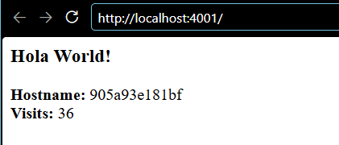
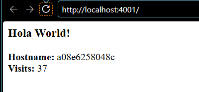
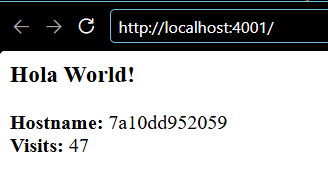
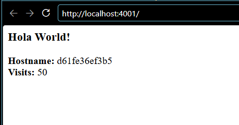
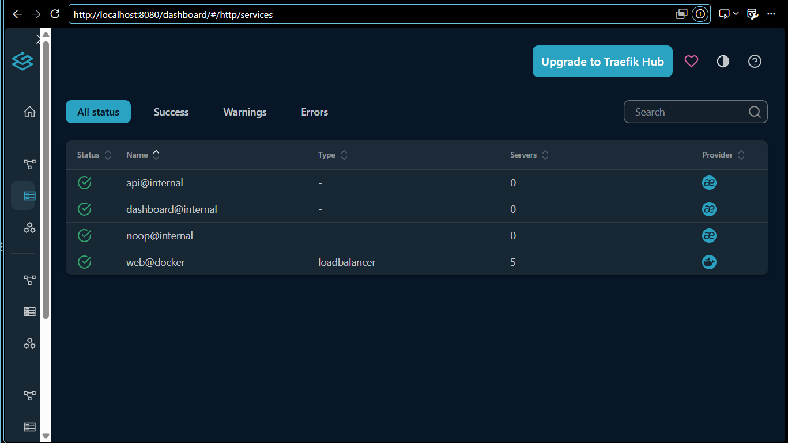

# Balanceo de carga con Traefik (Paso 6)

```bash
WEB_PORT=4001 docker compose -f docker-compose.traefik.yaml up -d --build --scale web=5
```

## 5 réplicas `healthy`

```text
NAME                      IMAGE               STATUS                    PORTS
friendlyhello-redis-1     redis:8.8           Up 11 seconds (healthy)   6379/tcp
friendlyhello-traefik-1   traefik:v3.7        Up 11 seconds             0.0.0.0:8080->8080/tcp, 0.0.0.0:4001->4000/tcp
friendlyhello-web-1       friendlyhello-web   Up 4 seconds (healthy)    8000/tcp
friendlyhello-web-2       friendlyhello-web   Up 5 seconds (healthy)    8000/tcp
friendlyhello-web-3       friendlyhello-web   Up 5 seconds (healthy)    8000/tcp
friendlyhello-web-4       friendlyhello-web   Up 6 seconds (healthy)    8000/tcp
friendlyhello-web-5       friendlyhello-web   Up 5 seconds (healthy)    8000/tcp
```

Las réplicas `web` **no publican puertos** (solo `8000/tcp` interno). Todo el tráfico externo entra por Traefik.

## Distribución de 20 peticiones

```text
Visits: 7   Hostname: 042216435bb6
Visits: 8   Hostname: 89444097c394
Visits: 9   Hostname: 60a65d0948c2
Visits: 10  Hostname: 95ccd20d84f0
Visits: 11  Hostname: 6e44d0d80547
Visits: 12  Hostname: 95ccd20d84f0
...
```

| Hostname (ID del contenedor) | Peticiones atendidas |
|------------------------------|---------------------:|
| `042216435bb6` | 4 |
| `60a65d0948c2` | 4 |
| `6e44d0d80547` | 4 |
| `89444097c394` | 4 |
| `95ccd20d84f0` | 4 |

Las **5 réplicas** atienden exactamente 4 peticiones cada una: Traefik reparte por turnos (*round-robin*). El contador sigue aumentando sin saltos (7, 8, 9…) porque todas comparten el mismo Redis. El estado vive en un único lugar y las réplicas web son **sin estado**, que es lo que permite escalarlas.






Las capturas se tomaron en una segunda ejecución (con otras réplicas, por eso los IDs no coinciden con la tabla de arriba). Muestran **4 de las 5 réplicas** (`905a93e181bf`, `a08e6258048c`, `7a10dd952059`, `d61fe36ef3b5`), que coinciden con la columna `CONTAINER ID` de `docker ps` de esa ejecución. Con esas mismas réplicas, 20 peticiones con `curl` se repartieron entre las 5:

```text
CONTAINER ID   NAMES                 STATUS
a08e6258048c   friendlyhello-web-2   Up 5 hours (healthy)
a467d71d7f9c   friendlyhello-web-1   Up 5 hours (healthy)
d61fe36ef3b5   friendlyhello-web-4   Up 5 hours (healthy)
905a93e181bf   friendlyhello-web-5   Up 5 hours (healthy)
7a10dd952059   friendlyhello-web-3   Up 5 hours (healthy)

      4 7a10dd952059
      4 905a93e181bf
      5 a08e6258048c
      4 a467d71d7f9c
      3 d61fe36ef3b5
```

En esta segunda medición el reparto no es exactamente 4-4-4-4-4. Las peticiones de las capturas manuales en el navegador también pasaron por el balanceador y movieron el turno del *round-robin*, que es compartido por todos los clientes. En el navegador, recargando a mano, la quinta réplica (`a467d71d7f9c`) no llegó a aparecer en las capturas, pero `curl` confirma que también atiende tráfico.

Salidas completas: [`evidencias/06-traefik.txt`](../blob/main/evidencias/06-traefik.txt) (primera ejecución) y [`evidencias/06-traefik-capturas.txt`](../blob/main/evidencias/06-traefik-capturas.txt) (ejecución de las capturas).

## Dashboard de Traefik

La API de Traefik confirma el servicio descubierto por las etiquetas, con 5 servidores:

```text
web@docker enabled 5 servidores
```

Salida: [`evidencias/06-traefik-dashboard-api.txt`](../blob/main/evidencias/06-traefik-dashboard-api.txt).



## Comprobación de la regla `Host(`localhost`)`

```text
$ curl http://127.0.0.1:4001
404 page not found
```

La regla del router compara el encabezado `Host`. `127.0.0.1` no coincide con `localhost`, así que Traefik no encuentra ruta y responde 404.

## Límites de la demostración

- Las 5 réplicas están en **una sola máquina** y comparten un **único Redis**. Si se cae el equipo o Docker, se cae todo; si se cae Redis, las réplicas siguen respondiendo pero sin contador (el `/health` no depende de Redis). Esto escala la capacidad, pero no da alta disponibilidad (ver [Reflexión](8-Reflexion)).
- `--api.insecure=true` deja el dashboard sin autenticación y montar `docker.sock` le da a Traefik control total sobre Docker. Ambas cosas solo son aceptables en local.
