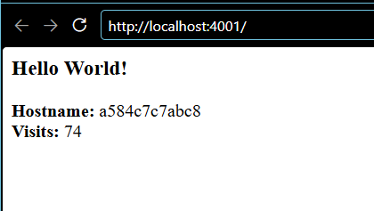

# Publicación en un registro (Parte 3)

## Docker Hub

**Imagen publicada:** https://hub.docker.com/r/DOCKERHUB_USER/friendlyhello

```bash
docker login
docker build -t DOCKERHUB_USER/friendlyhello:0.1.0 -t DOCKERHUB_USER/friendlyhello:latest friendlyhello
docker push DOCKERHUB_USER/friendlyhello:0.1.0
docker push DOCKERHUB_USER/friendlyhello:latest
```


### Por qué dos etiquetas

`0.1.0` y `latest` apuntan al **mismo *digest*** en este momento. La diferencia está en el tiempo:

- `0.1.0` es **inmutable** por convención: quien la use hoy o dentro de un año obtiene la misma imagen. Es la que se pone en un despliegue o en un archivo de Compose.
- `latest` se mueve con cada versión. Con la `0.2.0`, `latest` apuntará a la nueva y `0.1.0` seguirá disponible para hacer *rollback*.

Por eso el Ejercicio 1 usa `:0.1.0` y no `:latest`.

## GitHub Container Registry (GHCR)

El pipeline [`.github/workflows/ci.yml`](../blob/main/.github/workflows/ci.yml) publica las imágenes `friendlyhello` y `proyecto` en GHCR en cada *push* a `main`. Usa el `GITHUB_TOKEN` de la ejecución con permiso `packages: write`, sin tokens personales, y las etiqueta con el SHA del commit y con `latest`:

```text
ghcr.io/majo7-613/friendlyhello:<sha>
ghcr.io/majo7-613/proyecto:<sha>
```

## Ejercicio 1: usar la imagen publicada

[`friendlyhello/docker-compose.hub.yaml`](../blob/main/friendlyhello/docker-compose.hub.yaml) reemplaza `build: .` por la imagen del registro:

```yaml
services:
  web:
    image: ${DOCKERHUB_USER:?Defina DOCKERHUB_USER con su usuario de Docker Hub}/friendlyhello:0.1.0
```

```bash
docker rmi DOCKERHUB_USER/friendlyhello:0.1.0      # forzar la descarga desde Docker Hub
DOCKERHUB_USER=DOCKERHUB_USER WEB_PORT=4001 docker compose -f docker-compose.hub.yaml up -d
```


## Ejercicio 2: usar la imagen de un compañero

[`friendlyhello/docker-compose.companero.yaml`](../blob/main/friendlyhello/docker-compose.companero.yaml):

```bash
COMPANERO_IMAGE=COMPANERO_USER/friendlyhello:0.1.0 WEB_PORT=4001 docker compose -f docker-compose.companero.yaml up -d
```



Aquí se ve el valor de un registro: se ejecutó la aplicación de otra persona **sin tener su código ni construir nada**. Solo hizo falta el nombre de la imagen. Esto es lo que hace un servidor de despliegue con la imagen que publica el pipeline.
