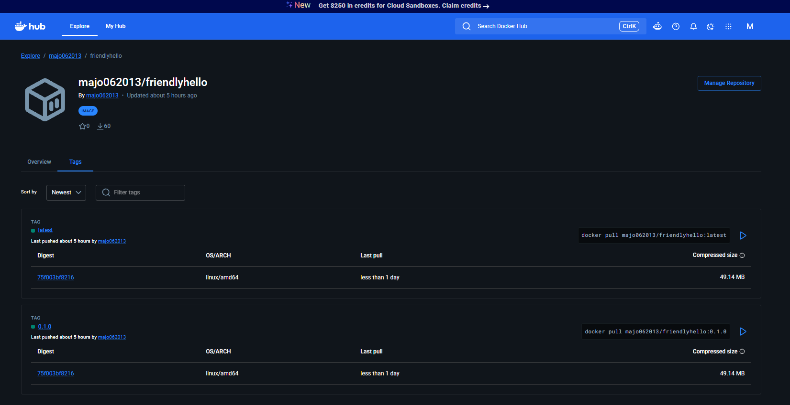

# Publicación en un registro (Parte 3)

## Docker Hub

**Imagen publicada:** https://hub.docker.com/r/majo062013/friendlyhello

```bash
docker login
docker build -t majo062013/friendlyhello:0.1.0 -t majo062013/friendlyhello:latest friendlyhello
docker push majo062013/friendlyhello:0.1.0
docker push majo062013/friendlyhello:latest
```

Las dos etiquetas quedaron publicadas con el mismo *digest*:

```text
Docker Hub: latest  sha256:4a6d8d5ea5d4…
Docker Hub: 0.1.0   sha256:4a6d8d5ea5d4…
```



En la página de Docker Hub el *digest* que aparece en cada etiqueta (`75f003bf8216`) es el del manifiesto de la plataforma `linux/amd64`; el `4a6d8d5ea5d4` de la terminal es el del índice que lo agrupa. Las dos etiquetas comparten ambos.

### Por qué dos etiquetas

`0.1.0` y `latest` apuntan al **mismo *digest*** en este momento. La diferencia está en el tiempo:

- `0.1.0` es **inmutable** por convención: quien la use hoy o dentro de un año obtiene la misma imagen. Es la que se pone en un despliegue o en un archivo de Compose.
- `latest` se mueve con cada versión. Con la `0.2.0`, `latest` apuntará a la nueva y `0.1.0` seguirá disponible para hacer *rollback*.

Por eso el Ejercicio 1 usa `:0.1.0` y no `:latest`.

## GitHub Container Registry (GHCR)

El pipeline [`.github/workflows/ci.yml`](../blob/main/.github/workflows/ci.yml) publica las imágenes `friendlyhello` y `proyecto` en GHCR en cada *push* a `main`. Usa el `GITHUB_TOKEN` de la ejecución con permiso `packages: write`, sin tokens personales, y las etiqueta con el SHA del commit y con `latest`:

```text
ghcr.io/majo7-613/friendlyhello:<sha>
ghcr.io/majo7-613/proyecto:<sha>
```

## Ejercicio 1: usar la imagen publicada

[`friendlyhello/docker-compose.hub.yaml`](../blob/main/friendlyhello/docker-compose.hub.yaml) reemplaza `build: .` por la imagen del registro:

```yaml
services:
  web:
    image: ${DOCKERHUB_USER:?Defina DOCKERHUB_USER con su usuario de Docker Hub}/friendlyhello:0.1.0
```

```bash
docker rmi majo062013/friendlyhello:0.1.0 majo062013/friendlyhello:latest   # forzar la descarga desde Docker Hub
DOCKERHUB_USER=majo062013 WEB_PORT=4001 docker compose -f docker-compose.hub.yaml up -d
```

```text
== docker images majo062013/friendlyhello (antes: no existe localmente)
REPOSITORY   TAG       IMAGE ID   CREATED   SIZE

 web Pulling
 c3d376f707e4 Already exists
 ...
 web Pulled
 Container friendlyhello-redis-1  Healthy
 Container friendlyhello-web-1  Started

NAME                    IMAGE                            STATUS                    PORTS
friendlyhello-redis-1   redis:8.8                        Up 19 seconds (healthy)   6379/tcp
friendlyhello-web-1     majo062013/friendlyhello:0.1.0   Up 12 seconds (healthy)   0.0.0.0:4001->8000/tcp

Hola World!  Hostname: 271bde3ad9d1  Visits: 28
Hola World!  Hostname: 271bde3ad9d1  Visits: 29
```

Compose descargó la imagen desde Docker Hub (`web Pulled`). Las capas aparecen como `Already exists` porque son las mismas de `python:3.14-slim`, que ya estaba en el equipo: Docker descarga **solo las capas que no tiene**, la misma idea de la caché del Paso 4. El contador siguió en 28 porque el volumen `./data` es el mismo de los pasos anteriores.


Salida completa: [`evidencias/11-ejercicio1.txt`](../blob/main/evidencias/11-ejercicio1.txt).

## Ejercicio 2: usar la imagen de un compañero

[`friendlyhello/docker-compose.companero.yaml`](../blob/main/friendlyhello/docker-compose.companero.yaml):

```bash
COMPANERO_IMAGE=COMPANERO_USER/friendlyhello:0.1.0 WEB_PORT=4001 docker compose -f docker-compose.companero.yaml up -d
```


Aquí se ve el valor de un registro: se ejecutó la aplicación de otra persona **sin tener su código ni construir nada**. Solo hizo falta el nombre de la imagen. Esto es lo que hace un servidor de despliegue con la imagen que publica el pipeline.
