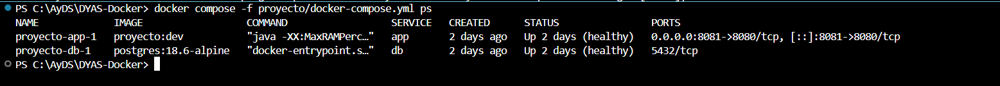
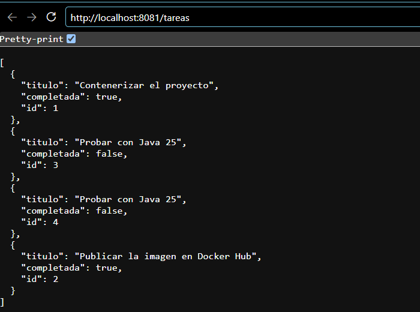

# Proyecto: aplicación Java contenerizada (Parte 4)

## La aplicación

[`proyecto/`](../blob/main/proyecto) es una API REST de **tareas** generada con Spring Initializr:

- **Spring Boot 4.1.2** sobre **Java 25 (LTS)**, con Spring Web MVC, Spring Data JPA, Validation y Actuator.
- **PostgreSQL 18.6** como base de datos, en su propio contenedor.
- 2 pruebas de integración con H2 en memoria, que corren con `mvn verify` en el pipeline de CI y localmente con Java 25.0.4.1: `Tests run: 2, Failures: 0, Errors: 0` ([`evidencias/07-mvn-verify.txt`](../blob/main/evidencias/07-mvn-verify.txt)).

| Método | Ruta | Descripción |
|--------|------|-------------|
| `GET` | `/` | Nombre de la aplicación, *hostname* del contenedor y número de tareas |
| `GET` | `/tareas` | Lista las tareas |
| `GET` | `/tareas/{id}` | Obtiene una tarea (404 si no existe) |
| `POST` | `/tareas` | Crea una tarea. El título es obligatorio (400 si está vacío) |
| `PUT` | `/tareas/{id}` | Actualiza el título y el estado |
| `DELETE` | `/tareas/{id}` | Elimina una tarea |
| `GET` | `/actuator/health/readiness` | Lo usa el `HEALTHCHECK` |

## Dockerfile *multi-stage*

```dockerfile
# syntax=docker/dockerfile:1

# Etapa 1: compilar el .jar con Maven (las pruebas ya corrieron en el pipeline de CI)
FROM maven:3.9.16-eclipse-temurin-25-noble AS build
WORKDIR /src
COPY pom.xml .
RUN --mount=type=cache,target=/root/.m2 mvn -B -ntp -q dependency:go-offline
COPY src ./src
RUN --mount=type=cache,target=/root/.m2 mvn -B -ntp -q package -DskipTests \
 && cp target/tareas-*.jar /app.jar

# Etapa 2: imagen final solo con el JRE y el .jar
FROM eclipse-temurin:25.0.4.1_1-jre-noble
# Las imágenes de Temurin 25 ya no traen curl: se instala solo para el HEALTHCHECK
RUN apt-get update \
 && apt-get install -y --no-install-recommends curl \
 && rm -rf /var/lib/apt/lists/* \
 && groupadd --system app && useradd --system --gid app --no-create-home app
WORKDIR /app
COPY --from=build --chown=app:app /app.jar app.jar
USER app
EXPOSE 8080

# Docker y Compose consultan este endpoint para saber si la aplicación está lista
HEALTHCHECK --interval=10s --timeout=3s --start-period=60s --retries=5 \
  CMD curl -fsS http://localhost:8080/actuator/health/readiness || exit 1

# La JVM usa como máximo el 75 % de la memoria que el contenedor tenga asignada
ENTRYPOINT ["java", "-XX:MaxRAMPercentage=75", "-jar", "/app/app.jar"]
```

| Decisión | Por qué |
|----------|---------|
| Dos etapas (`AS build` / `COPY --from=build`) | La etapa `build` tiene Maven y el JDK. La imagen final tiene el JRE, `curl` para el *healthcheck* y `app.jar`. |
| `pom.xml` → `dependency:go-offline` → `COPY src` | Mismo principio del [Paso 4](2-Cache-de-capas): al cambiar el código no se vuelven a descargar las dependencias. |
| `--mount=type=cache,target=/root/.m2` | El repositorio local de Maven se conserva entre *builds* y no queda dentro de ninguna capa. |
| `cp target/tareas-*.jar` | Se copia por el nombre del artefacto (`tareas`) y no con `*.jar`, como recomienda la guía: si algún día el *build* genera otro `.jar` (por ejemplo, de fuentes), `cp` no recibe dos archivos. |
| Versión completa de las imágenes base | `25.0.4.1_1` y no `25-jre`: la etiqueta no salta a otra versión de Java con el tiempo. Para una reproducibilidad total se podría fijar además el *digest* (`@sha256:…`), porque los mantenedores pueden volver a publicar una misma etiqueta con parches del sistema base. |
| `curl` instalado con `--no-install-recommends` | Ver el problema encontrado más abajo. |
| `USER app` | La JVM no corre como `root`. |
| `-XX:MaxRAMPercentage=75` | La JVM respeta el límite de memoria del contenedor. |

`docker build --check` del proyecto: `Check complete, no warnings found.` ([`evidencias/07-proyecto-build-check.txt`](../blob/main/evidencias/07-proyecto-build-check.txt)).

### Problema encontrado: `unhealthy` al pasar a Java 25

Al subir de Java 21 a Java 25 con la etiqueta `eclipse-temurin:25.0.1_8-jre-noble`, el contenedor respondía bien desde fuera, pero Docker lo marcaba **`unhealthy`**:

```text
proyecto-app-1   proyecto:dev   Up 3 minutes (unhealthy)
$ docker inspect -f '{{range .State.Health.Log}}{{.Output}}{{end}}' proyecto-app-1
/bin/sh: 1: curl: not found
```

La imagen de Temurin 21 trae `curl`, pero las de **Temurin 25 ya no**:

```text
eclipse-temurin:21.0.12.1_1-jre-noble    /usr/bin/curl
eclipse-temurin:25.0.1_8-jre-noble       curl: no existe
eclipse-temurin:25.0.4.1_1-jre-noble     curl: no existe
```
 La guía advierte de esto solo para las variantes `-alpine`. La solución fue:

1. Actualizar a `25.0.4.1_1-jre-noble` (agosto de 2026). La `25.0.1_8` tenía casi un año sin parches.
2. Instalar `curl` con `--no-install-recommends` y borrar `/var/lib/apt/lists` en la misma capa, para no dejar el índice de paquetes dentro de la imagen.

Evidencias: [`08-proyecto-java25-unhealthy.txt`](../blob/main/evidencias/08-proyecto-java25-unhealthy.txt) y [`07-temurin-curl.txt`](../blob/main/evidencias/07-temurin-curl.txt).

**Lección:** el `HEALTHCHECK` depende de herramientas que no son parte de la aplicación. Al cambiar la imagen base hay que volver a verificar que el contenedor llegue a `healthy`, no solo que la aplicación responda.

### `.dockerignore`

```text
target/
.git/
.github/
.idea/
.vscode/
.mvn/
mvnw
mvnw.cmd
*.md
.env
.env.*
docker-compose*.yml
Dockerfile
.dockerignore
```

`.env` nunca entra a la imagen y `target/` tampoco, porque el *jar* se compila dentro de la etapa `build`, no en el equipo.

## Compose con PostgreSQL

[`proyecto/docker-compose.yml`](../blob/main/proyecto/docker-compose.yml) levanta `app` y `db`. Las credenciales llegan desde `.env` (fuera del repositorio) y [`.env.example`](../blob/main/proyecto/.env.example) documenta qué variables hacen falta:

```bash
cp .env.example .env
docker compose up -d --build
```

```text
 Container proyecto-db-1  Started
 Container proyecto-db-1  Waiting
 Container proyecto-db-1  Healthy
 Container proyecto-app-1  Starting
 Container proyecto-app-1  Started
```

```text
NAME             IMAGE                  STATUS                    PORTS
proyecto-app-1   proyecto:dev           Up 16 seconds (healthy)   0.0.0.0:8080->8080/tcp
proyecto-db-1    postgres:18.6-alpine   Up 21 seconds (healthy)   5432/tcp
```



*En la captura la aplicación está publicada en el puerto **8081** (`APP_PORT=8081`) porque el 8080 lo ocupaba el dashboard de Traefik mientras se tomaban las capturas del Paso 6.*

- PostgreSQL **no publica puertos**: solo la aplicación lo alcanza, por el nombre `db` en la red de Compose.
- `SPRING_DATASOURCE_*` se convierten en `spring.datasource.*` sin tocar `application.properties`.
- Sin `.env`, Compose se detiene en vez de arrancar con credenciales vacías ([`evidencias/08-proyecto-sin-env.txt`](../blob/main/evidencias/08-proyecto-sin-env.txt)):

  ```text
  required variable POSTGRES_USER is missing a value: Defina POSTGRES_USER (ver .env.example)
  ```

## La aplicación funcionando en el contenedor

```text
$ curl localhost:8080/actuator/health/readiness
{"status":"UP"}

$ curl -X POST localhost:8080/tareas -H 'Content-Type: application/json' -d '{"titulo":"Probar con Java 25"}'
{"titulo":"Probar con Java 25","completada":false,"id":4}

$ curl -X POST localhost:8080/tareas -H 'Content-Type: application/json' -d '{"titulo":""}'
HTTP 400

$ curl -X PUT localhost:8080/tareas/2 -H 'Content-Type: application/json' -d '{"titulo":"Publicar la imagen en Docker Hub","completada":true}'
{"titulo":"Publicar la imagen en Docker Hub","completada":true,"id":2}

$ curl localhost:8080/
{"hostname":"e7dd9bd2a84c","tareas":4,"aplicacion":"tareas"}
```



*`GET /tareas` en el navegador, por el puerto 8081 (ver la nota de la captura anterior).*

Las tareas 1 y 2 se crearon en una ejecución anterior, con la imagen de Java 21. Después de `docker compose down`, reconstruir con Java 25 y volver a levantar, **siguen ahí**, porque están en el volumen `datos-db`, no en el contenedor ([`08-proyecto-java21.txt`](../blob/main/evidencias/08-proyecto-java21.txt) muestra la ejecución donde se crearon).

## Verificación de la imagen final

```text
$ docker exec proyecto-app-1 java -version
openjdk version "25.0.4.1" 2026-08-18 LTS

$ docker exec proyecto-app-1 id
uid=999(app) gid=999(app) groups=999(app)

$ docker exec proyecto-app-1 sh -c 'command -v mvn; command -v javac; ls /app'
mvn: no existe
javac: no existe
app.jar
```

| Imagen | Tamaño |
|--------|-------:|
| `maven:3.9.16-eclipse-temurin-25-noble` (solo la base de la etapa `build`, sin dependencias) | 689 MB |
| `proyecto:dev` (imagen final: JRE + `curl` + `app.jar`) | 542 MB |

Maven, el JDK, el código fuente y el `~/.m2` **no llegan a la imagen final**. La imagen final sigue siendo grande porque incluye Ubuntu 24.04 y el JRE completo; una base más pequeña (Alpine o *distroless*) la reduciría, a cambio de otras herramientas para el *healthcheck*.

## Integración continua

[`.github/workflows/ci.yml`](../blob/main/.github/workflows/ci.yml) aplica el checklist del Proyecto 3:

1. **`pruebas`**: `mvn verify` con Java 25.
2. **`imagenes`** (`needs: pruebas`): `docker build --check` de los dos Dockerfiles, construcción, escaneo con Trivy y, en `main`, publicación en GHCR con `GITHUB_TOKEN`.

La imagen **solo se construye si las pruebas pasan**. Por eso el Dockerfile usa `-DskipTests` sin perder garantías.

Salidas completas: [`evidencias/07-mvn-verify.txt`](../blob/main/evidencias/07-mvn-verify.txt), [`07-proyecto-build.txt`](../blob/main/evidencias/07-proyecto-build.txt) y [`08-proyecto.txt`](../blob/main/evidencias/08-proyecto.txt).
